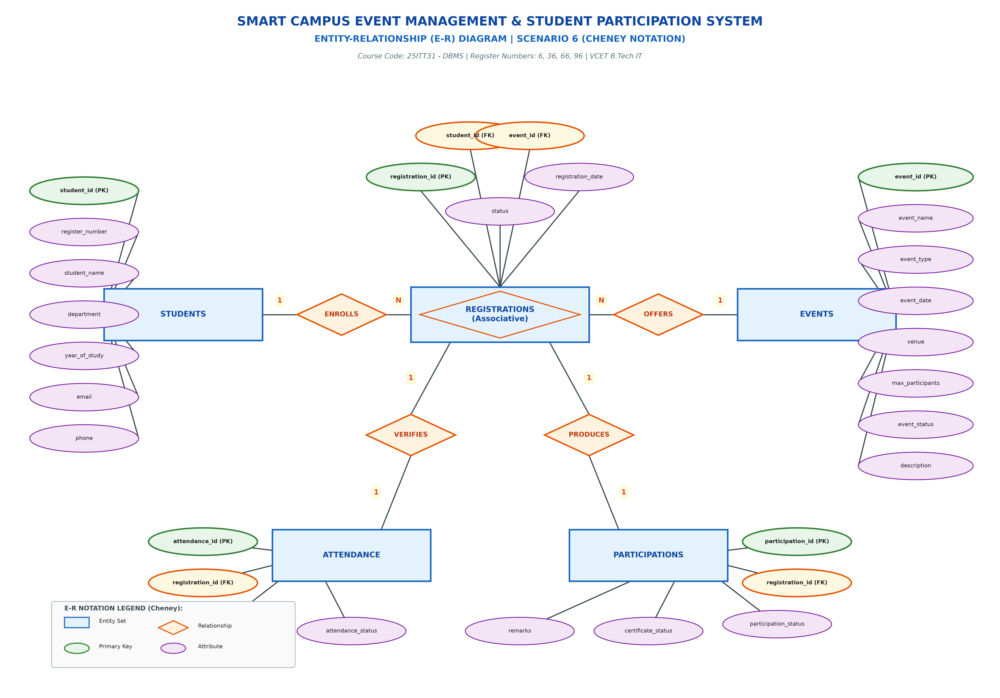
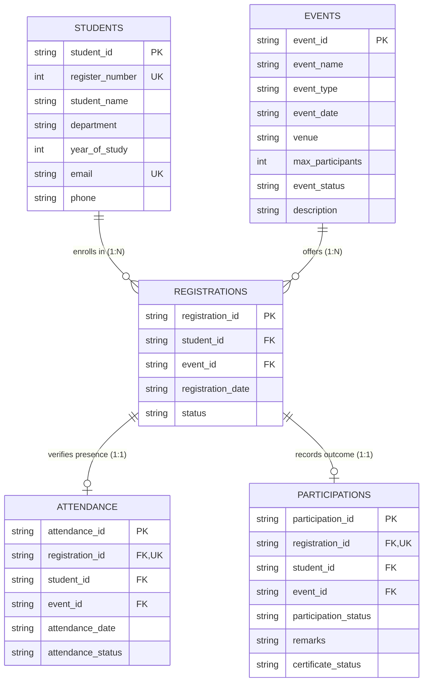

# TABLE RELATIONSHIPS & RELATIONAL ALGEBRA SPECIFICATION
## Scenario 6: Smart Campus Event Management and Student Participation Analysis System
### Register Numbers: 6, 36, 66, 96

---

## 0. Entity-Relationship (E-R) Diagram
The Entity-Relationship (E-R) model visually specifies all entities, attributes, primary/foreign keys, and relational cardinality for Scenario 6 in standard Cheney & Crow's Foot notations.

### Academic Cheney Notation High-Resolution Diagram:

### Interactive Conceptual ER Diagram (Crow's Foot):

---

## 1. Relational Schema Representation
The schema is defined in BCNF (Boyce-Codd Normal Form) to eliminate update, insertion, and deletion anomalies.

- **STUDENTS** (<ins>student_id</ins>, register_number, student_name, department, year_of_study, email, phone, created_at)
  - Primary Key: `student_id`
  - Candidate Key: `register_number`, `email`
  
- **EVENTS** (<ins>event_id</ins>, event_name, event_type, event_date, venue, max_participants, event_status, description, created_at)
  - Primary Key: `event_id`
  
- **REGISTRATIONS** (<ins>registration_id</ins>, student_id, event_id, registration_date, status, created_at)
  - Primary Key: `registration_id`
  - Foreign Key: `student_id` references `STUDENTS(student_id)`
  - Foreign Key: `event_id` references `EVENTS(event_id)`
  - Alternate Unique Key: (`student_id`, `event_id`)
  
- **ATTENDANCE** (<ins>attendance_id</ins>, registration_id, student_id, event_id, attendance_date, attendance_status, created_at)
  - Primary Key: `attendance_id`
  - Foreign Key: `registration_id` references `REGISTRATIONS(registration_id)` [UNIQUE]
  - Foreign Key: `student_id` references `STUDENTS(student_id)`
  - Foreign Key: `event_id` references `EVENTS(event_id)`
  
- **PARTICIPATIONS** (<ins>participation_id</ins>, registration_id, student_id, event_id, participation_status, remarks, certificate_status, created_at)
  - Primary Key: `participation_id`
  - Foreign Key: `registration_id` references `REGISTRATIONS(registration_id)` [UNIQUE]
  - Foreign Key: `student_id` references `STUDENTS(student_id)`
  - Foreign Key: `event_id` references `EVENTS(event_id)`

---

## 2. Cardinality and Mapping
1. **Student to Registration**: `1 : N` (One student can register for multiple events)
2. **Event to Registration**: `1 : N` (One event has multiple student registrations up to `max_participants`)
3. **Registration to Attendance**: `1 : 1` (Each registration has at most one attendance verification record)
4. **Registration to Participation**: `1 : 1` (Each registration has at most one activity participation outcome record)
5. **Student to Event (via Registration)**: `M : N` (Many-to-many relationship mediated through the `REGISTRATIONS` associative table)

---

## 3. Relational Algebra Operations

### A. Selection (σ) & Projection (π)
Retrieve IT department students registered for Event `EVT101`:
$$\pi_{student\_id, student\_name, department} (\sigma_{event\_id = 'EVT101' \land department = 'Information\ Technology'} (STUDENTS \bowtie REGISTRATIONS))$$

### B. Natural Join (⋈)
Retrieve student participation along with event titles:
$$\pi_{student\_name, event\_name, participation\_status} (STUDENTS \bowtie PARTICIPATIONS \bowtie EVENTS)$$

### C. Set Difference (-)
Identify students who have registered for events but have never attended any event:
$$\pi_{student\_id} (\sigma_{status = 'REGISTERED'} (REGISTRATIONS)) - \pi_{student\_id} (\sigma_{attendance\_status = 'PRESENT'} (ATTENDANCE))$$

---

## 4. Integrity Constraints & Business Logic Rules
1. **Entity Integrity**: Every primary key (`student_id`, `event_id`, etc.) must be non-null and strictly unique.
2. **Referential Integrity**: Cascading updates and restricted deletions are enforced on foreign keys to prevent orphan registrations.
3. **Domain Constraints**:
   - `year_of_study` ∈ {1, 2, 3, 4}
   - `event_type` ∈ {'Technical', 'Workshop', 'Seminar', 'Cultural', 'Sports', 'Competition', 'Symposium', 'Other'}
   - `event_status` ∈ {'UPCOMING', 'OPEN', 'ONGOING', 'COMPLETED', 'CANCELLED'}
   - `status` ∈ {'REGISTERED', 'CANCELLED', 'WAITLISTED'}
   - `attendance_status` ∈ {'PRESENT', 'ABSENT'}
   - `participation_status` ∈ {'PARTICIPATED', 'WINNER', 'RUNNER_UP', 'PARTICIPANT', 'NOT_PARTICIPATED'}
   - `certificate_status` ∈ {'ISSUED', 'PENDING', 'NOT_ELIGIBLE'}
