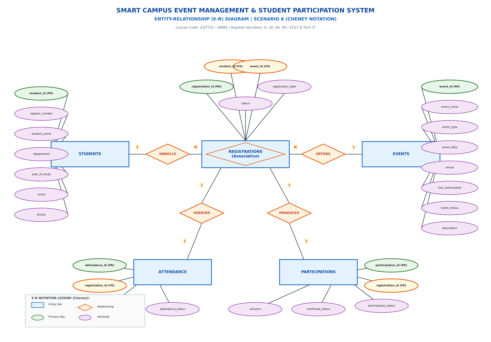
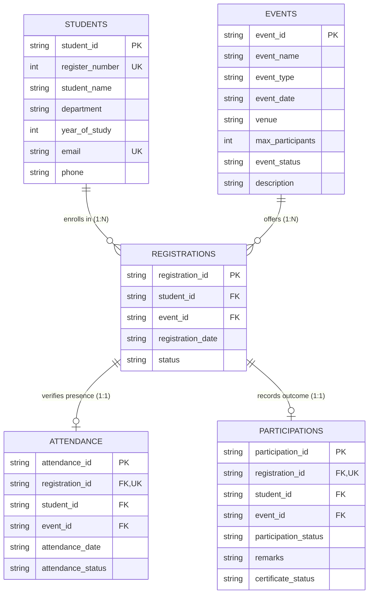

# SMART CAMPUS EVENT MANAGEMENT & STUDENT PARTICIPATION ANALYSIS SYSTEM
## Scenario 6: Academic Mini-Project & Engineering Suite
### Team Register Numbers: 6, 36, 66, 96
### Department: Information Technology, Velammal College of Engineering and Technology (VCET)

---

## 1. PROJECT OVERVIEW
The **Smart Campus Event Management and Student Participation Analysis System** is an enterprise-grade, centralized, menu-driven Windows CMD application. It integrates three foundational engineering subjects:
1. **Java Programming (25ITT32)**: Business logic, interactive console interface, transactional workflows, multi-tier service architecture, and dual logging.
2. **Database Management Systems (25ITT31)**: Relational schema in BCNF, ACID transactions, referential constraints, indexing, views, and data integrity.
3. **Foundations of Data Science (25ITC31)**: Python-based data cleaning, descriptive statistics, trend analysis, and 20 publication-quality visualizations using Pandas, Matplotlib, and Seaborn.

---

## 2. STRICT SUBJECT-WISE FOLDER ORGANIZATION
```
SmartCampusEventManagementSystem/
│
├── Java/
│   ├── Main Application/               (Central entry point, DualLogger, InputReader, PythonMenu)
│   ├── Student Management/             (Student model and interactive controller)
│   ├── Event Management/               (Event model, venue scheduling, and capacity controls)
│   ├── Event Registration Management/  (Registration model, atomic transactions, duplicate checks)
│   ├── Attendance Management/          (Attendance model, physical presence tracking, bulk entry)
│   ├── Participation Management/       (Participation model, awards, certificates, rankings)
│   ├── Dashboard/                      (Real-time live database dashboard and summaries)
│   ├── Reports and Analysis/           (23 analytical and statutory reports)
│   ├── Database Connectivity/          (DatabaseManager, JDBC connection pool, SQLite connector)
│   ├── Java Dependencies/              (sqlite-jdbc-3.46.1.0.jar, slf4j-api-1.7.36.jar)
│   └── bin/                            (Compiled bytecode .class files)
│
├── DBMS/
│   ├── Database Configuration/         (db_config.properties)
│   ├── Database Schema/                (schema.sql - DDL, Constraints, Indexes, Views)
│   ├── SQL Queries/                    (queries.sql - Analytical, reporting, and ranking queries)
│   ├── Table Relationships/            (relationships.md - Relational algebra and cardinality)
│   ├── Database Operations/            (db_operations.sql - ACID transactions, DML scripts)
│   ├── SQL Scripts/                    (init_database.sql - Seed data script)
│   ├── Database Documentation/         (DBMS_Documentation.md - Units 1 to 5 academic guide)
│   └── smart_campus_events.db          (SQLite database engine)
│
├── Python/
│   ├── Data Preprocessing/             (preprocess_data.py - Data cleaning and type conversion)
│   ├── Event Analysis/                 (event_analysis.py - Lifecycle and category analytics)
│   ├── Student Participation Analysis/ (participation_analysis.py - Outcomes and rankings)
│   ├── Attendance Analysis/            (attendance_analysis.py - Turnout and rates)
│   ├── Department Analysis/            (department_analysis.py - Branch metrics)
│   ├── Event Popularity Analysis/      (popularity_analysis.py - Conversion and demand)
│   ├── Event Capacity Analysis/        (capacity_analysis.py - Seat availability and utilization)
│   ├── Data Visualization/             (generate_visualizations.py, charts/ - 20 generated figures)
│   ├── Python Dependencies/            (requirements.txt)
│   └── run_python_analysis.py          (Interactive CLI & Java integration runner)
│
├── Output/
│   ├── SmartCampusEventManagement_Output.txt
│   ├── StudentManagement_Output.txt
│   ├── EventManagement_Output.txt
│   ├── EventRegistration_Output.txt
│   ├── AttendanceManagement_Output.txt
│   ├── ParticipationManagement_Output.txt
│   ├── EventAnalysis_Output.txt
│   ├── PythonAnalysis_Output.txt
│   └── DatabaseManagement_Output.txt
│
├── BAT/
│   ├── SmartCampusEventManagement.bat   (Master centralized application launcher)
│   ├── StudentManagement.bat            (Direct student module launcher)
│   ├── EventManagement.bat              (Direct event module launcher)
│   ├── EventRegistration.bat            (Direct registration module launcher)
│   ├── AttendanceManagement.bat         (Direct attendance module launcher)
│   ├── ParticipationManagement.bat      (Direct participation module launcher)
│   ├── EventAnalysis.bat                (Direct reports module launcher)
│   ├── PythonAnalysis.bat               (Direct Python analysis runner)
│   └── DatabaseManagement.bat           (Direct database utilities launcher)
│
├── SRS_Document.md                     (IEEE-830 Software Requirements Specification)
├── Test_Cases_Document.md              (Unit 4 Software Testing Suite & Verification)
├── E_R_Diagram.png                     (Academic Cheney & Crow's Foot E-R Diagram)
├── visuals_dashboard.html              (Standalone Visual Analytics Web Dashboard)
├── run_all.bat                         (Master Multi-Disciplinary Suite Launcher)
├── push_to_github.bat                  (Git Push Helper Script)
└── README.md                           (System Documentation)
```

---

## 3. HOW TO RUN THE APPLICATION

### Method A: One-Click Windows CMD Launch (Recommended)
Navigate to the `BAT/` folder and double-click any launcher:
- **`SmartCampusEventManagement.bat`**: Launches the complete centralized system with the main menu.
- **`StudentManagement.bat`**: Directly opens Student Management.
- **`EventManagement.bat`**: Directly opens Event Management.
- **`EventRegistration.bat`**: Directly opens Event Registration Management.
- **`AttendanceManagement.bat`**: Directly opens Attendance Management.
- **`ParticipationManagement.bat`**: Directly opens Participation Management.
- **`EventAnalysis.bat`**: Directly opens Event Analysis & Reports.
- **`PythonAnalysis.bat`**: Directly opens Python Data Analysis.
- **`DatabaseManagement.bat`**: Directly opens Database Management.

### Method B: Command Line (Windows CMD or PowerShell)
```cmd
cd "C:\Student event management"
java -cp "Java\bin;Java\Java Dependencies\*" SmartCampusEventManagementSystem
```

---

## 4. CENTRALIZED MAIN MENU
```
============================================================
SMART CAMPUS EVENT MANAGEMENT SYSTEM
STUDENT PARTICIPATION ANALYSIS

                   MAIN MENU

1. Dashboard
2. Student Management
3. Event Management
4. Event Registration Management
5. Attendance Management
6. Participation Management
7. Event Analysis & Reports
8. Python Data Analysis
9. Database Management
10. Exit

============================================================
Enter your choice:
```

---

## 5. BUSINESS RULES & DATA INTEGRITY
1. **Capacity Enforcement**: Events track active registrations against `max_participants`. Once full, students are placed on a waitlist or blocked from overbooking.
2. **Duplicate Prevention**: Database `UNIQUE(student_id, event_id)` constraint and pre-check in Java strictly prevent duplicate registrations.
3. **Attendance vs. Participation**: Physical presence (`PRESENT`/`ABSENT`) is recorded independently from event achievements (`WINNER`, `RUNNER_UP`, `PARTICIPATED`, `NOT_PARTICIPATED`).
4. **Certificate Eligibility**: Certificates are awarded only to students who were verified `PRESENT` and earned recognized participation status.
5. **Safe Referential Integrity**: Student or event records with existing active registrations cannot be deleted accidentally.
6. **Real-time Dual Output**: Every console output is simultaneously written to its dedicated file in `Output/` without locking or consuming interactive keyboard input.

---

## 6. ENTITY-RELATIONSHIP (E-R) DIAGRAM & DATABASE ARCHITECTURE
The database schema is modeled in Boyce-Codd Normal Form (BCNF) to guarantee lossless joins and prevent modification anomalies.

### High-Resolution Cheney Notation E-R Diagram


### Conceptual Schema (Crow's Foot Notation)


Detailed relational algebra, entity cardinalities, and normal form proofs are documented in [DBMS/Table Relationships/relationships.md](DBMS/Table%20Relationships/relationships.md).

