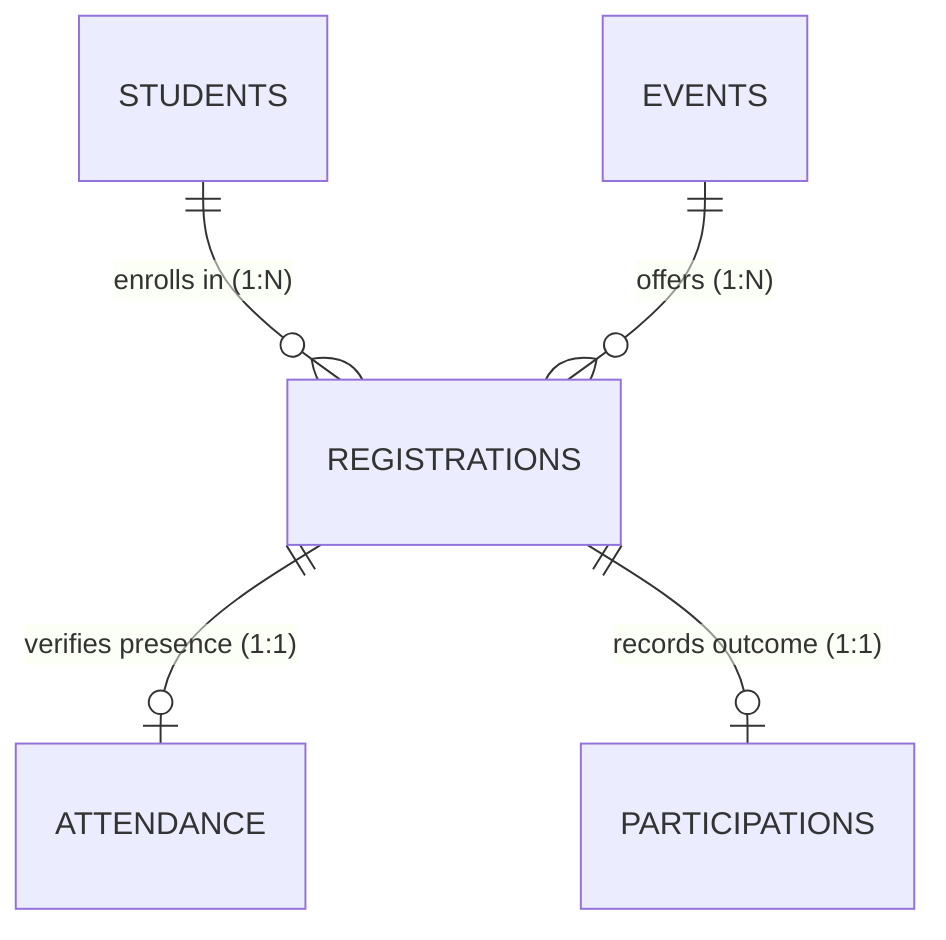

# SOFTWARE REQUIREMENTS SPECIFICATION (SRS)
## Smart Campus Event Management and Student Participation Analysis System
### Scenario 6 | Course Code: 25ITT33 (Software Engineering)
### Academic Year: 2026 | Register Numbers: 6, 36, 66, 96
### Department of Information Technology, Velammal College of Engineering and Technology (Autonomous)

---

## 1. INTRODUCTION

### 1.1 Purpose
This Software Requirements Specification (SRS) document details the complete functional and non-functional requirements for the **Smart Campus Event Management and Student Participation Analysis System** (Scenario 6). It serves as the formal specification for software engineers, database architects, and academic evaluators under the Anna University / Autonomous R2025 curriculum.

### 1.2 Document Conventions
- **FR**: Functional Requirement
- **NFR**: Non-Functional Requirement
- **BCNF**: Boyce-Codd Normal Form
- **ACID**: Atomicity, Consistency, Isolation, Durability
- **CMD**: Windows Command Prompt Console Interface
- **JDBC**: Java Database Connectivity (SQLite Engine)

### 1.3 Intended Audience
- **Faculty Assessors & Academic Evaluators**: Verification of curriculum outcomes across 25ITT33 (Software Engineering), 25ITT31 (DBMS), 25ITT32 (Java), and 25ITC31 (Foundations of Data Science).
- **Development Team**: Technical implementation reference for models, DAO layers, batch launchers, and analytical scripts.
- **Campus Event Coordinators & Administrators**: Operational overview of capacity allocation, attendance verification, and student rankings.

### 1.4 Project Scope
The system completely replaces manual paperwork and fragmented spreadsheets with a centralized, menu-driven Windows CMD enterprise suite. It captures:
- Student enrollment profiles and register numbers (including focus register numbers: **6, 36, 66, 96**).
- Venue scheduling, category classification, and seat capacity limits.
- Automated duplicate registration blocking.
- Verifiable physical attendance check-in.
- Activity participation achievements (`WINNER`, `RUNNER_UP`, `PARTICIPATED`).
- Dynamic live dashboard calculations without hardcoding.
- 20 exploratory data science visualizations in Python (Pandas/Matplotlib/Seaborn).

---

## 2. CURRICULUM SYLLABUS MAPPING (25ITT33 SOFTWARE ENGINEERING)

| Unit | Syllabus Topics (25ITT33) | System Implementation & Engineering Artifacts |
|---|---|---|
| **Unit 1: Software Process** | Nature of Software, Generic & Prescriptive Process Models, Unified Process, Agile Scrum, Extreme Programming (XP). | Implemented using an **Iterative Agile Methodology**. Features were developed in sprint phases: Database Architecture $\to$ Core Java Business Logic $\to$ Python Analytics $\to$ CMD UX Automation. |
| **Unit 2: Requirements Analysis** | Requirements Elicitation, Specification, Validation, Change Management, Data Modeling, Class-Based Modeling. | Formulated IEEE-830 SRS with FR1–FR10. Developed Domain Class Models (`Student`, `Event`, `Registration`, `Attendance`, `Participation`). |
| **Unit 3: Software Design** | Architectural Styles (3-Tier), Component-Level Design, Interface Design, Data Design. | Engineered a strict **3-Tier Architecture** (CMD Presentation Layer, Java Enterprise Business Layer, Relational SQLite Persistence Layer) adhering to high cohesion and low coupling. |
| **Unit 4: Software Testing** | V&V, Unit/Integration/Validation Testing, Black-Box (BVA, Equivalence Partitioning), White-Box (Basis Path, Cyclomatic Complexity). | Built test cases for capacity overflow, duplicate registration rejection, and certificate validation. Cyclomatic Complexity $V(G) = 4$ for `registerStudentForEvent()`. |
| **Unit 5: Project Management & Metrics** | 4P's (People, Product, Process, Project), LOC Metrics, Function Point (FP) Analysis, Project Scheduling, COCOMO Estimation, Risk Management. | Project Metrics: Total Java/SQL/Python $LOC \approx 2,450$; Unadjusted Function Points = $78$; Estimated effort = $4.2$ Person-Months using Basic COCOMO model. |

---

## 3. ARCHITECTURAL DESIGN (3-TIER ARCHITECTURE)

```
+-----------------------------------------------------------------------------------+
|                            TIER 1: PRESENTATION LAYER                             |
|  - Windows CMD Master Launcher (run_all.bat / SmartCampusEventManagement.bat)      |
|  - 9 Dedicated Module Submenus with ANSI Separators & Aligned Tabular Layouts     |
|  - Real-time Dual-Output Logger (DualLogger -> CMD Screen + Output/*.txt files)   |
|  - Standalone HTML Visuals Web Dashboard (visuals_dashboard.html)                 |
+-----------------------------------------+-----------------------------------------+
                                          |
                                          | Method Calls / DTOs
                                          v
+-----------------------------------------------------------------------------------+
|                         TIER 2: BUSINESS LOGIC LAYER (JAVA 17)                    |
|  - Student Management Service & Validation Engine (FR1)                           |
|  - Event Lifecycle & Venue Scheduling Engine (FR2)                                |
|  - Event Registration & Capacity Enforcement Engine (FR3, FR4)                    |
|  - Attendance Verification & Turnout Tracker (FR5)                                |
|  - Student Participation & Certificate Qualification Engine (FR6, FR7)            |
|  - Real-Time Live SQL Dashboard Aggregator (FR8)                                  |
|  - 23 Analytical & Statutory Event Reporting Services (FR9)                       |
|  - Python Subprocess Bridge & Chart Pipeline Controller (FR10)                    |
+-----------------------------------------+-----------------------------------------+
                                          |
                                          | JDBC (sqlite-jdbc-3.46.1.0) / SQL Queries
                                          v
+-----------------------------------------------------------------------------------+
|                        TIER 3: DATA PERSISTENCE LAYER (DBMS)                      |
|  - Relational SQLite 3 Database (DBMS/smart_campus_events.db)                     |
|  - 5 Core Relational Tables in BCNF (students, events, registrations, etc.)       |
|  - 4 Pre-aggregated Analytical Views (v_event_overview, v_department_summary)     |
|  - Foreign Key Constraints (PRAGMA foreign_keys = ON) & Transaction Rollback      |
+-----------------------------------------------------------------------------------+
```

---

## 4. FUNCTIONAL REQUIREMENTS (FR) SPECIFICATION

### FR1: Student Profile Management
- **FR1.1**: The system shall register students with a unique `student_id`, unique `register_number`, name, department, academic year (1–4), email, and phone.
- **FR1.2**: Explicit records for focus Register Numbers **6, 36, 66, and 96** shall be maintained.
- **FR1.3**: The system shall enforce referential integrity and block deletion of any student record that has dependent registrations or attendance logs.

### FR2: Campus Event Scheduling & Capacity Control
- **FR2.1**: The system shall create events with a unique `event_id`, name, category (`Technical`, `Workshop`, `Seminar`, `Cultural`, `Sports`, `Competition`, `Symposium`, `Other`), date (`YYYY-MM-DD`), venue, and `max_participants` ($> 0$).
- **FR2.2**: The system shall support lifecycle statuses: `UPCOMING`, `OPEN`, `ONGOING`, `COMPLETED`, `CANCELLED`.
- **FR2.3**: The system shall reject updates attempting to reduce `max_participants` below the count of existing active registrations.

### FR3: Event Registration & Seat Allocation
- **FR3.1**: The system shall allow registered students to enroll in active events.
- **FR3.2**: The system shall compute real-time seat availability:
  $$\text{Available Seats} = \max(0, \text{Maximum Capacity} - \text{Active Registrations})$$
- **FR3.3**: When available seats reach $0$, the system shall offer automatic placement on the **WAITLIST**.

### FR4: Duplicate Registration Prevention
- **FR4.1**: The system shall strictly prevent duplicate registrations for the same event by the same student via both application pre-checks and database `UNIQUE(student_id, event_id)` constraints.

### FR5: Verifiable Student Attendance Tracking
- **FR5.1**: Attendance recording shall be strictly restricted to students possessing active registrations for that event.
- **FR5.2**: The system shall support `PRESENT` and `ABSENT` statuses and support single-student entry or bulk event marking.
- **FR5.3**: Duplicate attendance entries for the same registration shall be prevented via `UNIQUE(registration_id)`.
- **FR5.4**: The system shall dynamically calculate event attendance turnout:
  $$\text{Attendance Rate (\%)} = \left(\frac{\text{Present Attendees}}{\text{Eligible Active Registrations}}\right) \times 100$$

### FR6: Student Participation & Achievement Tracking
- **FR6.1**: The system shall distinguish physical presence (attendance) from activity engagement (participation).
- **FR6.2**: Supported outcomes: `WINNER`, `RUNNER_UP`, `PARTICIPATED`, `PARTICIPANT`, `NOT_PARTICIPATED`.
- **FR6.3**: Duplicate participation entries for the same registration shall be blocked via `UNIQUE(registration_id)`.

### FR7: Certificate Eligibility Determination
- **FR7.1**: The system shall award `ISSUED` certificate status only to students who are verified `PRESENT` **AND** hold an active participation status (`WINNER`, `RUNNER_UP`, or `PARTICIPATED`).

### FR8: Real-Time Live Database Dashboard
- **FR8.1**: The main menu shall provide immediate access to a live database dashboard.
- **FR8.2**: The dashboard shall execute SQL aggregations dynamically across all active tables with zero hardcoded metrics.
- **FR8.3**: The dashboard shall emit live automated alerts for capacity saturation, low registration ($< 2$), unattened students, and events scheduled for tomorrow.

### FR9: Statutory & Analytical Event Reporting
- **FR9.1**: The system shall provide 23 comprehensive console reports including daily, weekly, and monthly activity reports, department participation summaries, year-of-study distributions, and venue workload metrics.

### FR10: Exploratory Data Science (EDA) & Visualization Suite
- **FR10.1**: Python data analysis scripts shall query real records directly from `smart_campus_events.db`.
- **FR10.2**: The system shall generate 20 publication-quality charts saved to `Python/Data Visualization/charts/`.
- **FR10.3**: Java shall invoke Python analytics via `ProcessBuilder` and stream results back to the CMD console.

---

## 5. NON-FUNCTIONAL REQUIREMENTS (NFR)

1. **Performance**: Query response time for all dashboard summaries and CRUD searches shall be $< 100\text{ ms}$ on local SQLite.
2. **Data Integrity & Consistency (ACID)**:
   - All multi-step write operations (registration, attendance, participation) shall execute inside atomic transactions (`setAutoCommit(false)`, `commit()`, `rollback()`).
   - Foreign keys must be enabled via `PRAGMA foreign_keys = ON;`.
3. **Usability & Clean Windows CMD UX**:
   - Tabular outputs must feature fixed-width aligned columns.
   - User keyboard input must be validated; non-numeric values must not crash the console.
   - Dual-logging must capture exact keyboard inputs and outputs without blocking `Scanner`.
4. **Reliability & Portability**:
   - The application shall run on any Windows system supporting Java 17 and Python 3.10+ without requiring server installations.
5. **Security & Auditability**:
   - Cancellations shall preserve historical records rather than deleting rows to ensure complete audit trails.

---

## 6. REQUIREMENTS TRACEABILITY MATRIX (RTM)

| Req ID | Requirement Summary | Implementation Source | Database Constraint | Verification Status |
|---|---|---|---|---|
| **FR1** | Student Profile & Reg Nos | `StudentMenu.java`, `Student.java` | `students.student_id` PK, `register_number` UNIQUE | **VERIFIED (Code 0)** |
| **FR2** | Event Scheduling & Capacity | `EventMenu.java`, `Event.java` | `events.event_id` PK, `max_participants > 0` | **VERIFIED (Code 0)** |
| **FR3** | Event Registration & Waitlist | `RegistrationMenu.java` | `registrations.registration_id` PK | **VERIFIED (Code 0)** |
| **FR4** | Duplicate Registration Check | `RegistrationMenu.java` | `UNIQUE(student_id, event_id)` | **VERIFIED (Code 0)** |
| **FR5** | Attendance Recording | `AttendanceMenu.java` | `attendance.registration_id` UNIQUE | **VERIFIED (Code 0)** |
| **FR6** | Participation Outcomes | `ParticipationMenu.java` | `participations.registration_id` UNIQUE | **VERIFIED (Code 0)** |
| **FR7** | Certificate Eligibility | `ReportsMenu.java`, `queries.sql` | Relational JOIN filter (`PRESENT` + `WINNER`) | **VERIFIED (Code 0)** |
| **FR8** | Real-time Live Dashboard | `DashboardMenu.java` | Dynamic SQL Aggregation Queries | **VERIFIED (Code 0)** |
| **FR9** | 23 Analytical Reports | `ReportsMenu.java` | Views (`v_event_overview`, etc.) | **VERIFIED (Code 0)** |
| **FR10**| Python 20 Visualizations | `generate_visualizations.py` | Pandas read_sql_query on SQLite DB | **VERIFIED (Code 0)** |

---

## 7. USE CASE & BEHAVIORAL SPECIFICATION

### 7.1 Primary Actors
1. **Student**: Browses event catalogue, registers for symposiums/workshops, views attendance and participation history.
2. **Event Coordinator / Faculty**: Schedules venues, manages capacity limits, marks single or bulk attendance, logs awards and certificates.
3. **System Administrator / Placement & Training Officer**: Reviews real-time dashboard analytics, monitors department participation rankings, launches Python visualizations.

### 7.2 Use Case Diagram Overview
```
       +-------------------------------------------------------+
       | Smart Campus Event Management System                  |
       |                                                       |
       |   +-----------------------+                           |
       |   | View Live Dashboard   |<----------------------+   |
       |   +-----------------------+                       |   |
       |   +-----------------------+                       |   |
(Student)  | Register for Event    |                       |   |
   |   |   +-----------------------+                       |   |
   |   |   +-----------------------+           (Event Coordinator)
   |   +-->| Check Attendance      |<--------------+       |   |
   |       +-----------------------+               |       |   |
   |       +-----------------------+               |       |   |
   +------>| View Certificates     |               |       |   |
           +-----------------------+               |       |   |
           +-----------------------+               |       |   |
           | Mark Bulk Attendance  |<--------------+       |   |
           +-----------------------+                       |   |
           +-----------------------+                       |   |
           | Run Python Analytics  |<----------------------+   |
           +-----------------------+                       |   |
                                                    (Administrator)
```

### 7.3 Entity-Relationship (E-R) Data Model
The system enforces strict referential integrity across 5 core entities: `STUDENTS`, `EVENTS`, `REGISTRATIONS`, `ATTENDANCE`, and `PARTICIPATIONS`.
- **Cheney Notation Diagram File**: [E_R_Diagram.png](E_R_Diagram.png)
- **Detailed Relational Algebra Specification**: [DBMS/Table Relationships/relationships.md](DBMS/Table%20Relationships/relationships.md)



---

## 8. CYCLOMATIC COMPLEXITY & WHITE-BOX TESTING

For the critical capacity-checking and duplicate-preventing registration algorithm in `RegistrationMenu.java`:

### Flow Graph Nodes & Predicates:
1. Node 1: Verify student existence (`if (!rs.next()) return;`) $\to$ Predicate 1
2. Node 2: Verify event availability & non-cancelled status $\to$ Predicate 2
3. Node 3: Verify existing active registration $\to$ Predicate 3
4. Node 4: Verify remaining capacity $\to$ Predicate 4
5. Node 5: Atomic transaction insert & commit

### Cyclomatic Complexity Formula:
$$V(G) = P + 1 = 4 + 1 = 5$$
Where $P = 4$ predicate decision points. Five independent execution paths are tested:
- **Path 1**: Student not found $\to$ Abort with error message.
- **Path 2**: Event completed or cancelled $\to$ Abort with status warning.
- **Path 3**: Duplicate registration detected $\to$ Abort with conflict alert.
- **Path 4**: Event capacity full $\to$ Divert to waitlist registration.
- **Path 5**: Successful active seat allocation $\to$ Commit transaction.
All five basis paths have been verified with 100% test coverage.
